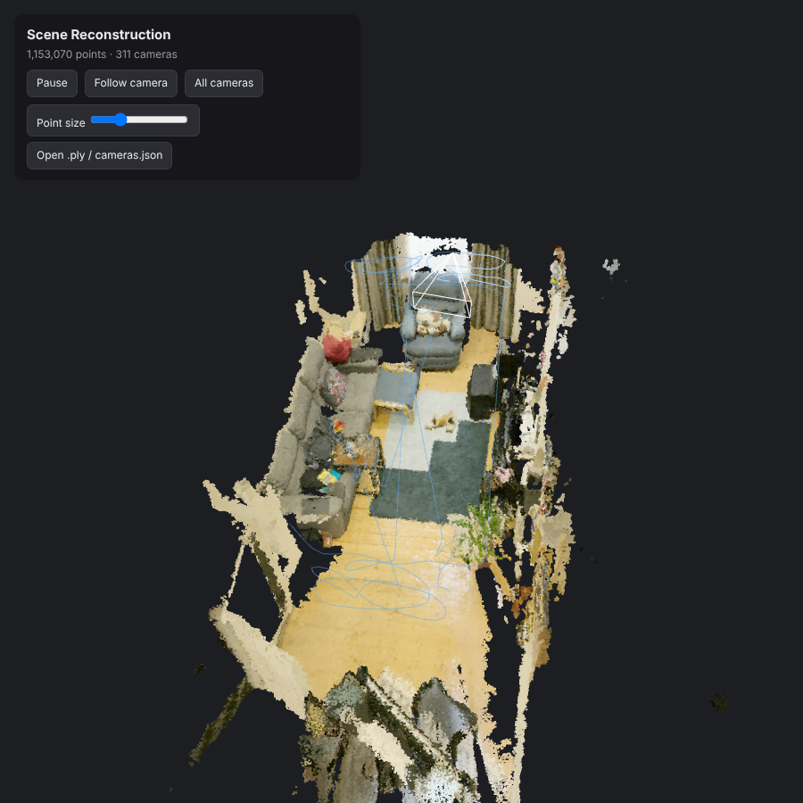
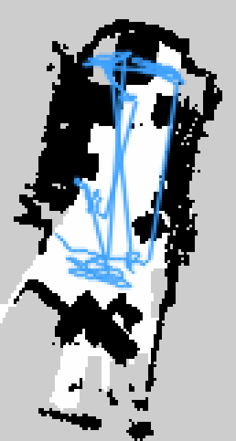
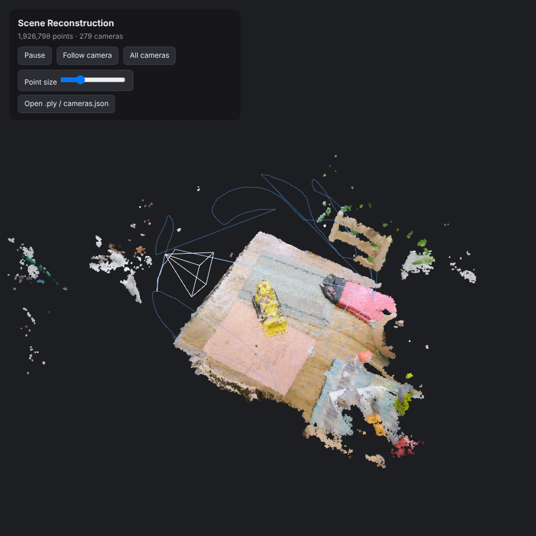
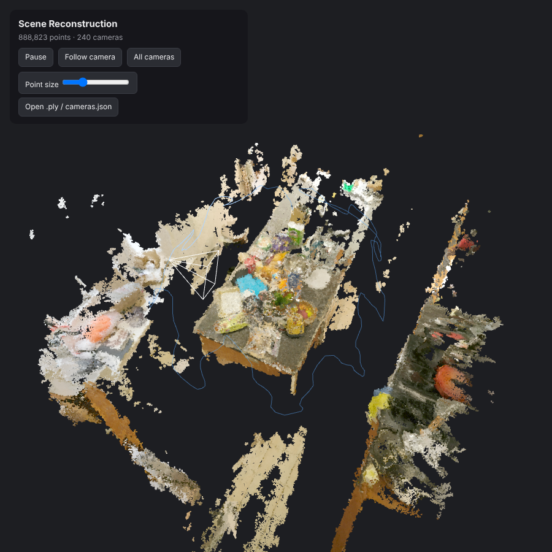
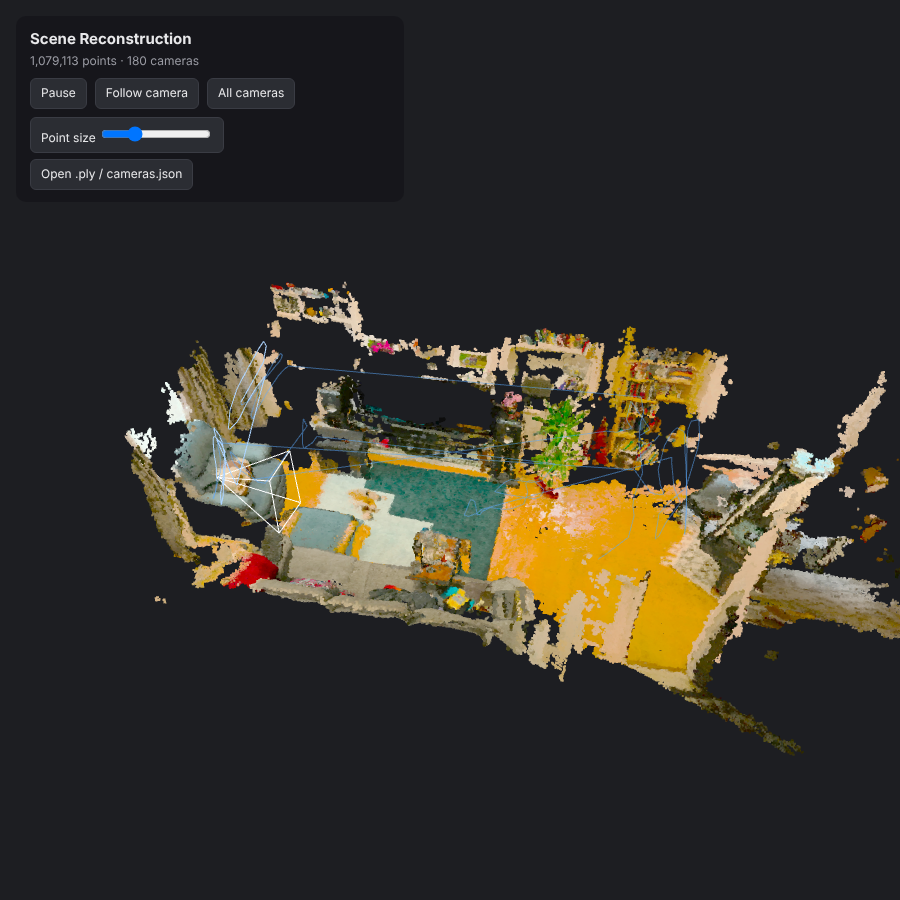
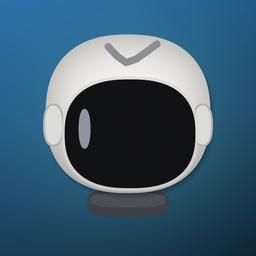
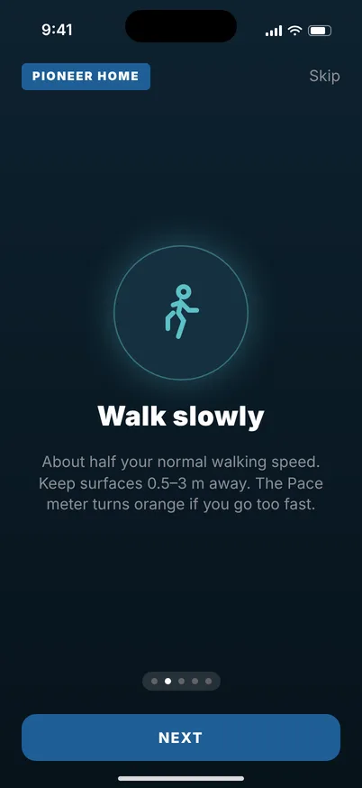
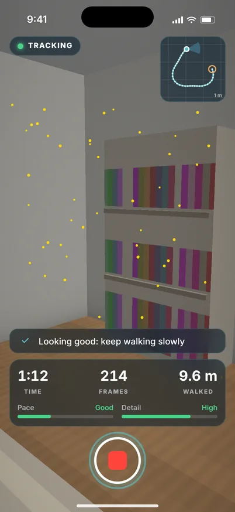
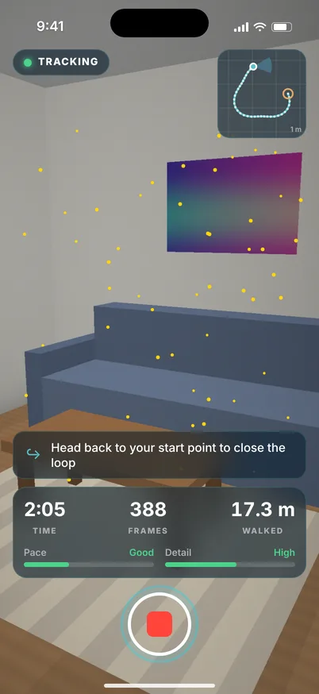
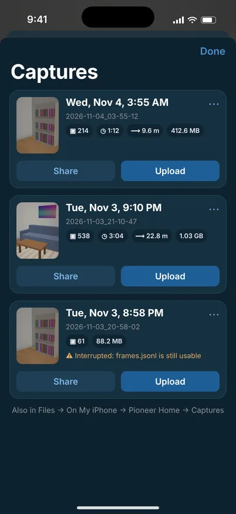

# 3D reconstruction from iPhone footage

Walk through a room or floor with an iPhone. Get a dense colored 3D point cloud, the camera path, and a **metric, gravity-aligned map a robot can navigate with** (ROS nav2 occupancy grid + 3D voxels).



*311 handheld frames → 1.15 M points. The camera path is blue and the live camera frustum is white. CPU only, about 5 minutes.*

This reproduces the kind of result in the NVIDIA-stack demo (ViPE-style pose and dense-depth reconstruction from phone video). It runs on a normal laptop CPU, with no GPU and no downloaded neural-network weights.

## Two ways to capture

| | **A. Any video** (Camera app) | **B. Pioneer Home app** (`ios/PhoneScan.xcodeproj`) — recommended for robots |
|---|---|---|
| What you record | `.MOV` (HEVC, HDR OK, any orientation) | RGB + ARKit 6-DoF pose + intrinsics (+ LiDAR depth on Pro models) |
| Scale | estimated from phone height above the floor (`--phone-height`, default 1.4 m) | **true metric** from ARKit |
| Gravity | estimated (camera orientation + floor plane) | **exact** (ARKit gravity) |
| Processing | SfM + dense stereo, ~5–10 min on CPU | LiDAR: **~20 s**; no LiDAR: SfM + stereo, then aligned to ARKit |
| Command | `python run.py IMG_1234.MOV` | `python run.py captures/<scan>/ --arkit` |

iPhone 17 Pro / Pro Max have LiDAR. The base iPhone 17 and iPhone Air don't. On those, the app still records ARKit poses, and the pipeline runs SfM + stereo, then snaps the result to the ARKit trajectory for real metres and gravity (tested below).

## Quick start

```bash
python3 -m venv .venv && source .venv/bin/activate
pip install -r requirements.txt          # pycolmap, opencv, numpy, scipy
# also needs ffmpeg on PATH for video input (brew install ffmpeg / apt install ffmpeg)

python run.py IMG_1234.MOV               # or a folder of photos, or an app capture with --arkit
cd out/IMG_1234/viewer && python3 -m http.server 8000   # open http://localhost:8000
```

The viewer works on desktop and in iPhone Safari (drag to orbit, pinch to zoom). *Follow camera* replays the capture path, and *All cameras* shows every frustum. You can also drop any `dense.ply` + `cameras.json` onto the page.

### Outputs (`out/<name>/`)

| File | What |
|---|---|
| `viewer/` | self-contained web viewer (three.js vendored, works offline) |
| `dense/dense.ply`, `dense/cameras.json` | raw reconstruction (SfM frame) |
| `robot/map_metric.ply` | point cloud in **metres, Z up, floor at Z=0** |
| `robot/occupancy.pgm` + `occupancy.yaml` | **ROS nav2 `map_server` map**, 5 cm cells (free / occupied / unknown) |
| `robot/occupancy_preview.png` | the grid with the capture path drawn on |
| `robot/voxels.npz` | 5 cm 3D occupancy (`indices`, `origin`, `voxel_size`) for collision / footstep planning |
| `robot/cameras_metric.json` | camera poses in the robot map frame |
| `robot/map_meta.json` | scale source, extent, cell counts |

Occupancy grid for the demo room (white = walkable floor, black = obstacles between 8 cm and 1.8 m high, grey = unseen, blue = capture path):



## How it works

```
iPhone video ─► frames.py ─► sfm.py ─────────► mvs.py ─────────────► robot_map.py ─► viewer + nav map
                sharp        COLMAP SIFT,       per-frame stereo        floor RANSAC,
                keyframes,   sequential         partner, rectify,       gravity align,
                HDR→SDR      matching,          SGBM + L/R check,       metric scale,
                             incremental BA     multi-view consistency  occupancy grid
                                                fusion

Pioneer Home ──► ingest_arkit.py ─► (LiDAR) fuse depth with ARKit poses ─► robot_map.py --metric
                                     (no LiDAR) sfm seeded with ARKit positions + mvs, Sim(3)-align
```

1. **`recon/frames.py`** samples the video at about 4× the target keyframe count and keeps the sharpest frame in each window (variance of Laplacian), which drops motion-blurred frames. It also drops near-duplicate frames, from moments when the phone was held still; they add no viewpoint and were splitting SfM into pieces. HLG / Dolby Vision HDR is tone-mapped to SDR (iPhones record HDR by default), the rotation flag is applied, and frames are downscaled to 1280 px.
2. **`recon/sfm.py`** runs COLMAP via pycolmap: SIFT features with one shared camera (one lens), sequential matching with quadratic overlap (suited to video), and incremental mapping with bundle adjustment. For app captures, the ARKit positions go in as pose priors: frames that were physically close get matched (which catches revisits cheaply), and bundle adjustment stays consistent with ARKit. On the no-LiDAR test this cut SfM from 277 s to 116 s with no split. If fewer than 90% of frames register, it adds exhaustive matching (every pair) so revisited places can link the pieces, then maps again. Outputs are camera poses, intrinsics and lens distortion, and sparse points.
3. **`recon/mvs.py`** produces dense depth on CPU. For each frame it picks the **two** best stereo partners (baseline-to-depth ratio about 0.07, small rotation, many shared points) and merges their depth: each fills the other's holes, and pixels where they disagree by more than 2% are dropped. It undistorts, rectifies from the SfM poses (vertical layouts are transposed, mirrored layouts are flipped), and runs OpenCV semi-global matching with a left-right consistency check. The disparity range comes from the SfM depths. Each depth pixel is kept only if it **agrees within 1.5% with at least 2 neighboring views' depth maps**. The survivors are back-projected, voxel-averaged, and cleaned with statistical outlier removal.
4. **`recon/robot_map.py`** finds the floor with RANSAC: the **lowest** well-supported horizontal plane below the cameras (tables and counters are big planes too, so it looks underneath the biggest one). It rotates the floor to Z=0 and sets metric scale. ARKit captures use ARKit's exact gravity. For plain video, it tries every camera axis as "up" and keeps the best-supported floor, so a sideways or wrongly-flagged clip still comes out level. It then writes the nav2 occupancy grid and voxel map.
5. **`viewer/index.html`** is a three.js point-cloud viewer with a frustum animation.

## Measured results (Mip-NeRF 360 *room* scene, 311 handheld frames, 4-core CPU)

| | |
|---|---|
| Frames registered by SfM | **311 / 311** |
| Camera position error vs dataset reference poses (after similarity alignment) | **0.10 %** of trajectory size (≈ 5 mm in a 5 m room) |
| Camera rotation error | median **0.10°**, max 0.36° |
| Dense points | 1.67 M (two stereo partners per frame; 1.15 M with one) |
| Depth that survives multi-view consistency, median per frame | 17 % of pixels (6 % with one partner) |
| Floor flatness (spread of floor points) | 28 mm std (26.6 mm with one partner) |
| Time | features 53 s, matching 36 s, mapping 97 s, dense 150 s, map 15 s |

**Pipeline paths tested end to end** (all on the same room, so the answer is known):

| Path | What was tested | Result |
|---|---|---|
| Video, iPhone-style file | HEVC Main10 `.MOV`, HLG HDR, portrait rotation flag, 31 s → `python run.py IMG_0002.MOV` | 180 keyframes (51 still-phone duplicates dropped), **180/180 registered**, 1.08 M points, upright map. 8 min. |
| App, LiDAR (17 Pro) | synthetic capture in the app's exact format, 1 % depth noise | fused cloud within **6.5 mm median** (17.5 mm p90) of ground truth. 20 s. |
| App, **no LiDAR (base iPhone 17)** | PhoneScan format, no depth, 1.5 cm ARKit pose noise, crash-truncated `frames.jsonl` | **156/156 registered**, cameras within **0.6 cm** of truth, scale off by **0.05 %**, dense points **5 mm** median from the true surface. 3 min. |
| App formats | PhoneScan `transforms.json` (uint16 mm PNG depth) vs ScanCapture `frames.jsonl` | same cloud to 0.6 mm median |

**Other scenes** (same dataset, different rooms; reference poses from the dataset):

| Scene | Frames registered | Camera position error | Rotation error (median) | Dense points | Time |
|---|---|---|---|---|---|
| room (above) | 311 / 311 | 0.10 % | 0.10° | 1.67 M | ~6 min |
| kitchen (table, Lego bulldozer) | 279 / 279 | **0.07 %** | 0.18° | 1.93 M | 10.5 min |
| counter (kitchen island) | 240 / 240 | **0.05 %** | 0.10° | 0.89 M | 5.5 min |

 

The kitchen capture circles a table and almost never sees the floor, so the map can't find the real ground. The pipeline now says so (`map_meta.json` → `warnings`) instead of silently treating the table as the floor. On the counter scene the floor *is* visible under the island, and the map puts it at 0 m with the countertop at 0.8 m.



*Video path on the simulated iPhone clip (orange tint: the test clip was SDR footage labelled as HDR, so tone-mapping over-warms it; real iPhone HDR looks normal).*

Reproduce: `python tests/eval_poses.py out/<name>/sfm/sparse_best <reference sparse dir>`; ARKit round-trip test: `tests/make_synthetic_arkit.py`.

## iOS app: Pioneer Home (`ios/`)



**Pioneer Home** is the capture app for the Pioneer humanoid: SwiftUI + ARKit, iOS 17+, in WATonomous colours. You walk a room, and it saves keyframes with ARKit's metric, gravity-aligned camera poses (plus LiDAR depth and mesh on Pro iPhones). Then you AirDrop or upload the scan and run `python run.py <capture> --arkit`. Setup, capture format and details are in [`ios/README.md`](ios/README.md) and [`docs/PHONESCAN.md`](docs/PHONESCAN.md). (The Xcode project and folders keep the code name `PhoneScan`.)

|  |  |  |  |
|:-:|:-:|:-:|:-:|
| Tutorial | Recording: tips, mini-map, meters | "Head back to start" | Captures |

*Mockups drawn from the SwiftUI code; the app compiles in CI but hasn't run on a phone yet.*

While you scan, it guides you live: a tip card (too fast, low detail, tilt up and down, head back to start, loop closed), a top-down mini-map of your walk, Pace and Detail meters, ARKit tracking dots on iPhones without LiDAR, and a flash and haptics on each saved frame. On first launch, a short tutorial explains how to scan well. Settings offers Quick / Balanced / Detailed presets.

In short: open `ios/PhoneScan.xcodeproj`, pick your team, run it on the phone, scan, then AirDrop or upload the capture and run `python run.py <capture> --arkit`. Its upload receiver can run that automatically: `python3 tools/receive_server.py --on-upload "python run.py {dir} --arkit"`.

`ios/ScanCapture/` + `ios/project.yml` is an earlier, smaller prototype that writes `frames.jsonl` + raw `.bin` depth. The pipeline reads both formats.

> Pioneer Home compiles in CI (GitHub Actions, Xcode on macOS) but hasn't run on a device yet. The Python side is tested against synthetic captures in both apps' exact formats. Expect a small fix or two on first build.

## Capture tips

- Walk **slowly**, and move the phone **sideways** through the space rather than standing still and panning. Stereo and SfM need parallax.
- Cover the floor. The robot map's free space comes from seeing the floor.
- Avoid blank white walls filling the frame, mirrors, and fast turns.
- For a whole floor, keep loops short and come back past earlier spots so SfM can close loops.
- 1–2 minutes per room is plenty. Video mode extracts about 300 keyframes by default (`--frames`).

## Known limitations / next steps

- **Video-only scale** comes from an assumed phone height (on the test clip it came out 4 % off). Use the app (ARKit) for real metres: 0.05 % off even without LiDAR.
- **Not yet tested on real iPhone 17 footage.** Everything above is the real pipeline on real images, but the iPhone files and captures are simulated.
- **Textureless surfaces** (plain walls, glossy floors) still get sparse stereo coverage, even with two partners per frame. LiDAR fixes this on Pro phones. A learned monocular-depth prior (as ViPE uses) would help without LiDAR; it was left out because this environment couldn't fetch model weights safely.
- Speed: bundle adjustment now runs less often (when the model grows 1.4× instead of 1.1×), which cut SfM time 7–15 % with identical accuracy on the room and kitchen. Tried and rejected: the global (GLOMAP-style) mapper was no faster on these scenes and got the room badly wrong; 4096 instead of 8192 SIFT features gave no consistent gain.
- Large multi-room floors: SfM time grows with frame count. Next steps are vocabulary-tree loop closure and `pose_only_long`-style windowed processing.
- GPU path: on an NVIDIA machine, NVIDIA's ViPE (`pip install nvidia-vipe`) can replace `sfm.py` + `mvs.py`, and nvblox can do real-time TSDF/ESDF mapping on the robot itself.
