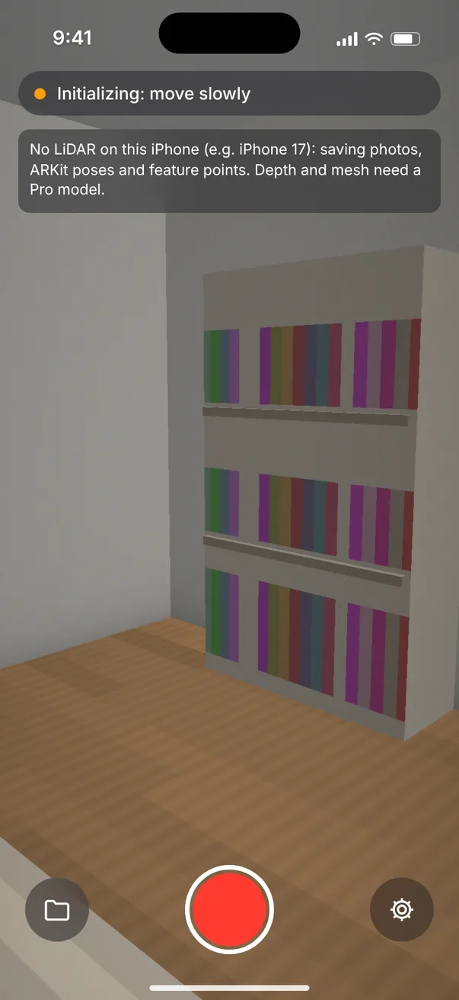
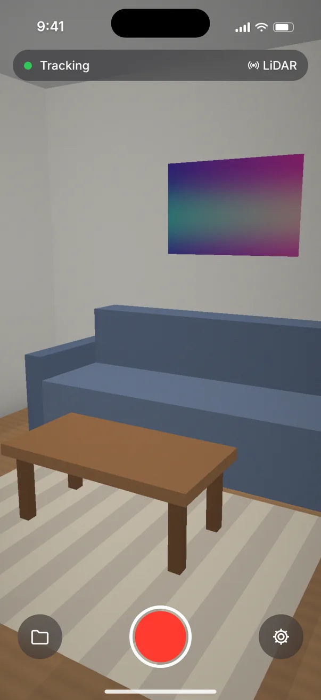
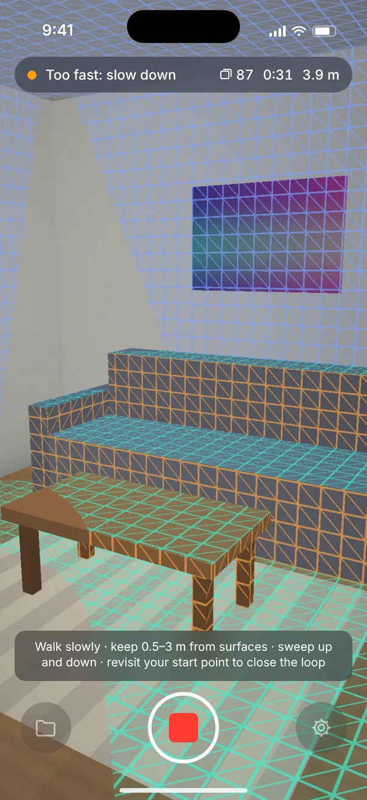
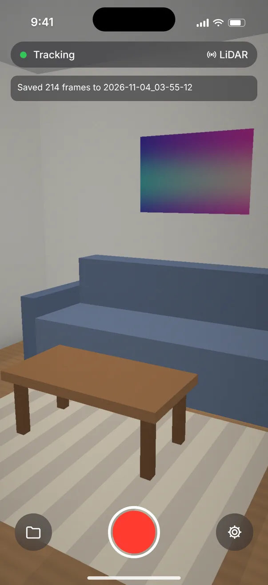
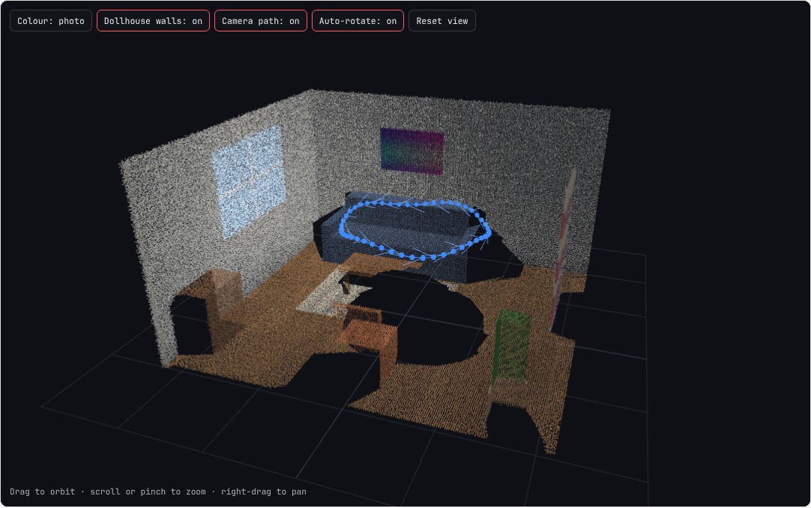
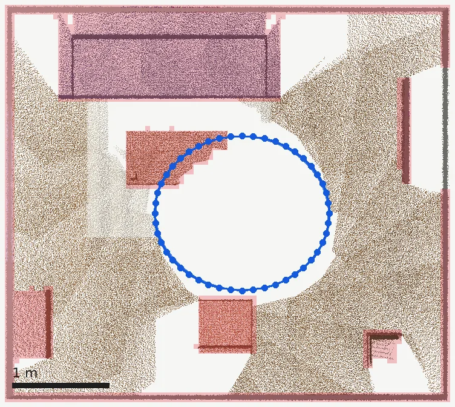
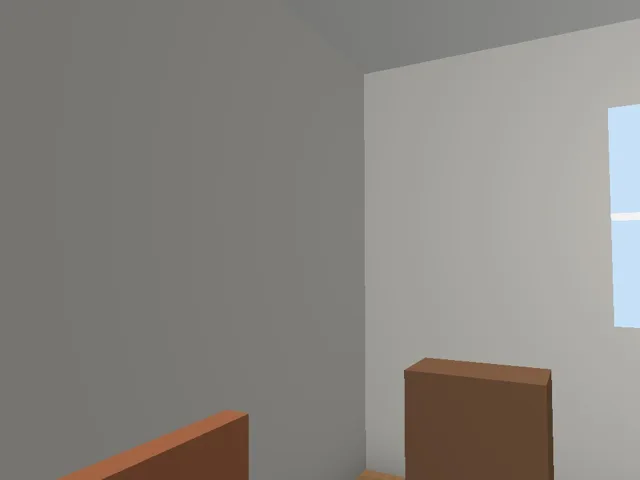
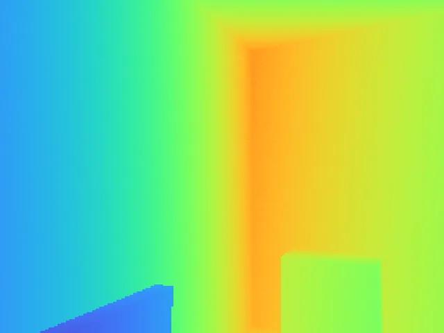

# PhoneScan documentation

The full illustrated guide is published as an artifact. This file holds the images and a short index;
`ios/README.md` has the setup, format and reconstruction commands.

## Screens (mockups from the SwiftUI layout, not device captures)

| | | | |
|---|---|---|---|
|  iPhone 17 starting |  iPhone 17 recording |  Pro ready |  Pro recording + mesh |
|  Tracking warning |  Saved |  Captures |  Settings |

## Real tool output (synthetic 48-frame capture in the app's exact format)

One keyframe:   

`fuse_depth.py`: 48 frames, 2,342,201 raw points, 1,349,750 after 1 cm voxels. The cloud measures
4.60 × 2.65 × 4.09 m for a 4.5 × 2.6 × 4.0 m room.
