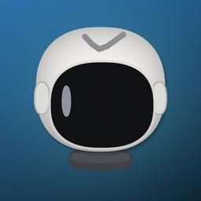
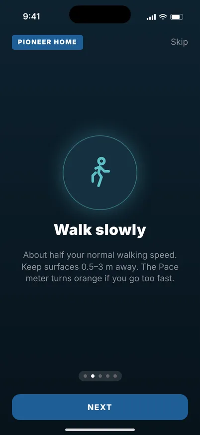
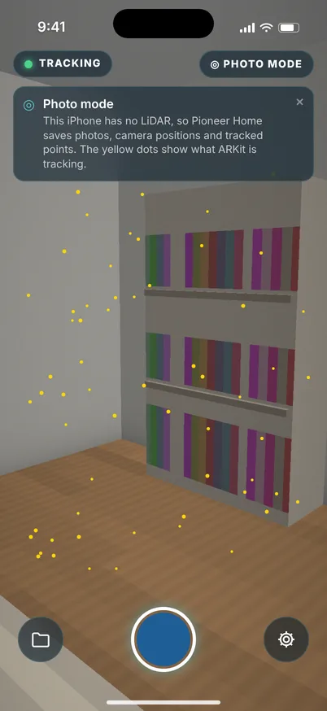
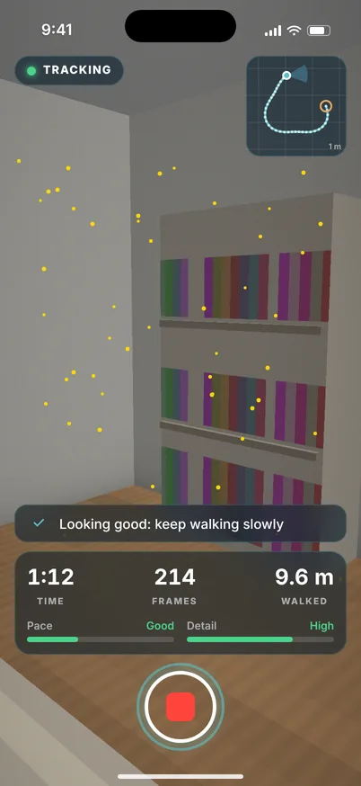
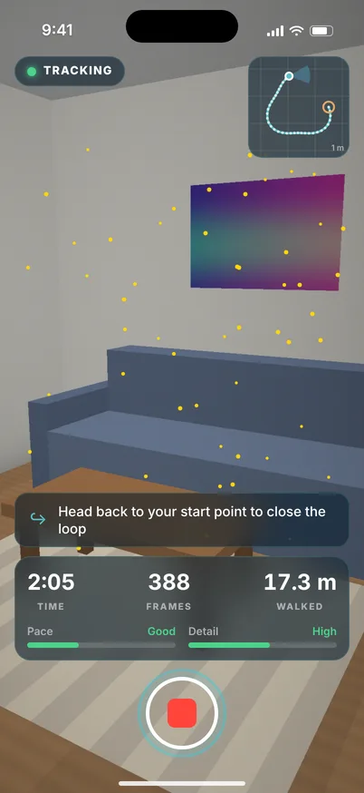
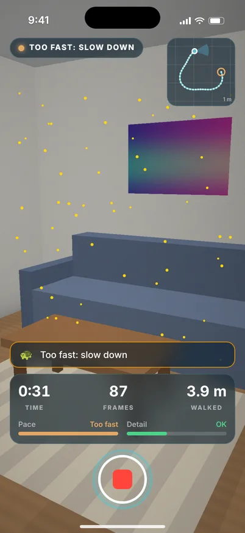
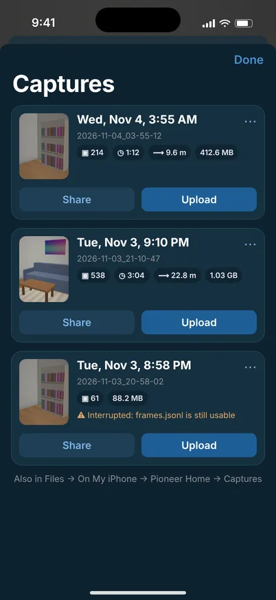
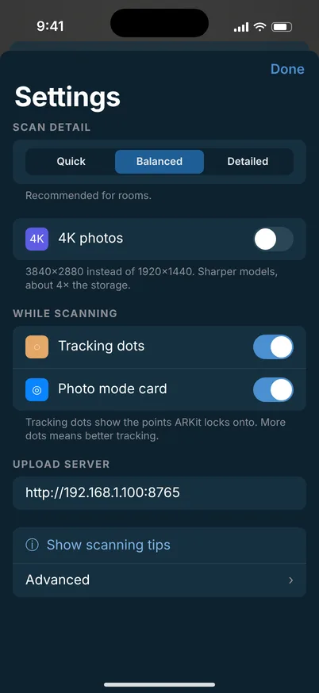
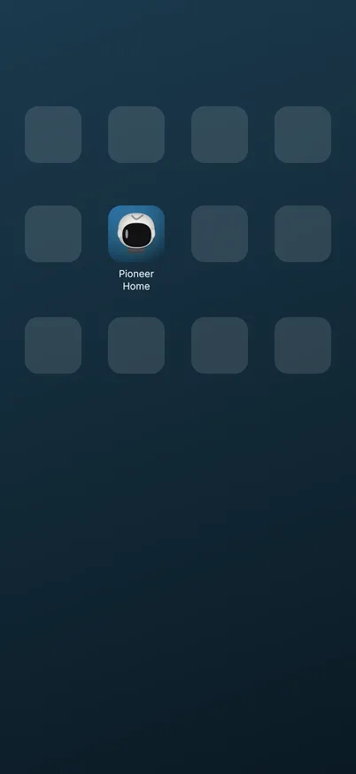

# Pioneer Home documentation

The full illustrated guide is published as an artifact. This file holds the images and a short index;
`ios/README.md` has the setup, format and reconstruction commands.

## Screens (mockups from the SwiftUI layout, not device captures)

|  |  |  |  |
|:-:|:-:|:-:|:-:|
| Tutorial | Ready (iPhone 17) | Recording | Head back to start |
|  |  |  |  |
| Too fast | Captures | Settings | Home screen |

## Real tool output (synthetic 48-frame capture in the app's exact format)

One keyframe:   

`fuse_depth.py`: 48 frames, 2,342,201 raw points, 1,349,750 after 1 cm voxels. The cloud measures
4.60 × 2.65 × 4.09 m for a 4.5 × 2.6 × 4.0 m room.
