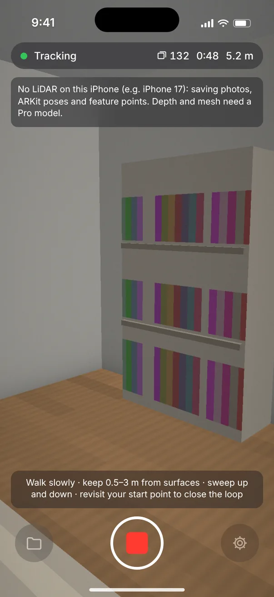
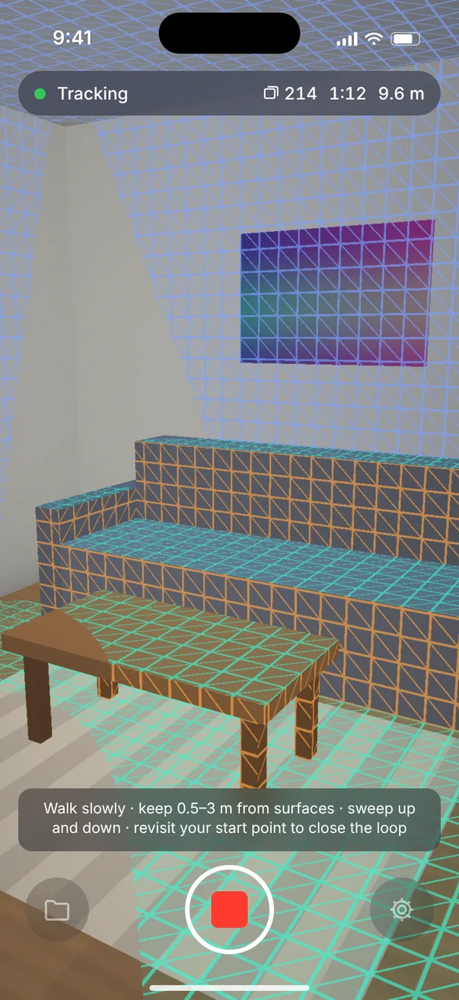
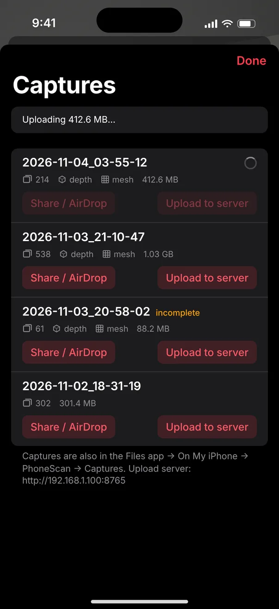
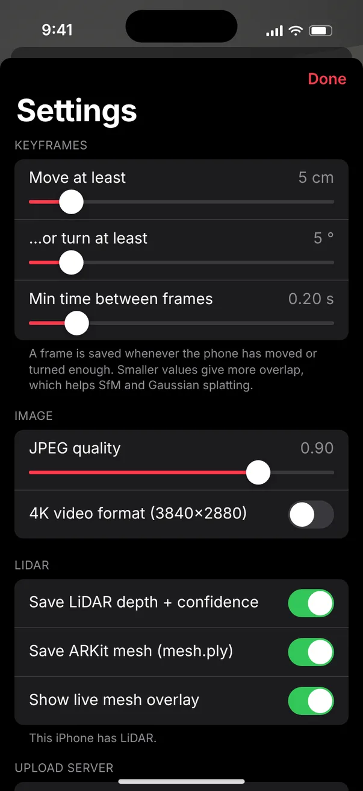

# PhoneScan: iPhone capture app for 3D reconstruction

A native SwiftUI + ARKit app that turns an iPhone into a scanning rig for room- and floor-scale
reconstruction, built with the Pioneer humanoid (WATonomous) in mind: the robot gets a
metric, gravity-aligned map instead of an arbitrarily scaled SfM model.

While you walk around, PhoneScan saves **keyframes**: an RGB JPEG plus ARKit's 6-DoF pose and
intrinsics, and on LiDAR iPhones the depth map, confidence map and the live ARKit mesh. The
output drops straight into nerfstudio / gsplat, COLMAP (with known poses) or a plain depth-fusion
point cloud.

| iPhone | Photos + ARKit poses | ARKit feature points | LiDAR depth | ARKit mesh |
|---|---|---|---|---|
| iPhone 17 Pro / Pro Max (and 12 Pro or later Pros) | ✅ | ✅ | ✅ | ✅ |
| **iPhone 17**, 17 Air, and other non-Pro models | ✅ | ✅ | none (no LiDAR) | none |

On an iPhone 17 the reconstruction is photo-based: COLMAP triangulation with the ARKit poses, or
Gaussian splatting from `transforms.json`. Both stay metric and gravity-aligned, because ARKit's
poses come from the camera + IMU. `arkit_points.ply` gives splatting a real-scale starting cloud.
Only `tools/fuse_depth.py` needs LiDAR.

Requires iOS 17 or later and Xcode 16 or later.

## Screens

Mockups drawn from the SwiftUI layout (the app hasn't been built on a device yet).
Full documentation: [`docs/PHONESCAN.md`](../docs/PHONESCAN.md).

| iPhone 17 (no LiDAR) | Pro, recording with mesh | Captures | Settings |
|---|---|---|---|
|  |  |  |  |

## Install on your iPhone

1. Open `ios/PhoneScan.xcodeproj` in Xcode 16 or later on a Mac.
2. Select the **PhoneScan** target → *Signing & Capabilities* → pick your **Team** (a free
   personal Apple ID works). If Xcode says the bundle ID is taken, change
   `com.allenabraham.PhoneScan` to something unique.
3. Plug in the iPhone, enable **Developer Mode** on it (Settings → Privacy & Security), pick it
   as the run destination and press **Run** (⌘R).
4. With a free Apple ID, also trust the developer on the phone: Settings → General →
   VPN & Device Management. Free-account installs expire after 7 days; re-run from Xcode.

If the project ever fails to open, regenerate it: `brew install xcodegen && cd ios && xcodegen --spec PhoneScan.yml`. (`ios/project.yml` belongs to the separate ScanCapture prototype.)

## Capturing

* Tap the red button and walk **slowly**. Keep surfaces 0.5–3 m away and sweep the phone up and
  down. Finish where you started so ARKit can close the loop.
* The status pill shows the tracking state, frame count, time and distance walked. Frames are only
  kept while tracking is *normal*, and when the phone has moved ≥ 5 cm or turned ≥ 5° (tunable in
  Settings).
* On LiDAR phones, the wireframe overlay shows which parts are already covered.
* Tap stop. The capture is written to *Files → On My iPhone → PhoneScan → Captures*.

## Getting captures off the phone

* **AirDrop / Files / share sheet:** Captures → *Share / AirDrop* zips the folder.
* **Straight to a laptop or the robot over Wi-Fi:** run the receiver on that machine:

  ```bash
  python3 tools/receive_server.py --port 8765 --dir captures
  ```

  In the app, Settings → Upload server = `http://<that-machine-ip>:8765`, then tap *Upload to
  server*. Add `--on-upload "python run.py {dir} --arkit"` to run the full reconstruction
  pipeline (viewer + nav2 occupancy map) on each upload, or
  `--on-upload "python3 tools/fuse_depth.py {dir}"` for a quick LiDAR cloud.

## Capture format

```
2026-11-04_03-55-12/
  images/frame_00000.jpg        RGB, sensor orientation (landscape), sRGB JPEG, 1920x1440 (or 3840x2880 in 4K mode)
  depth/frame_00000.png         LiDAR depth, uint16 PNG, millimetres, 256x192, 0 = invalid
  confidence/frame_00000.png    uint8 PNG, 0 low / 1 medium / 2 high
  transforms.json               nerfstudio format, every frame has its own intrinsics + pose
  frames.jsonl                  the same records appended live, so a crash keeps what was captured
  mesh.ply                      ARKit scene mesh with normals, world frame (LiDAR only)
  arkit_points.ply              ARKit feature points, sparse metric cloud (every iPhone; referenced as ply_file_path)
  metadata.json                 device model, iOS version, settings, counts
```

**Conventions.** `transform_matrix` is ARKit's camera-to-world transform, row-major, metres.
The camera axes follow OpenGL (+x right, +y up, looking down −z) and the world is gravity-aligned
with +y up. That is nerfstudio's convention, so `transforms.json` works as-is. To get OpenCV/COLMAP
axes, right-multiply by `diag(1, -1, -1, 1)`. The tools below do this for you. Intrinsics
(`fl_x, fl_y, cx, cy`) are for the full-resolution JPEG; scale them by `256/1920` for depth.

## Reconstruct

The main pipeline at the repo root reads PhoneScan captures directly (`recon/ingest_arkit.py`):

```bash
python run.py captures/2026-11-04_03-55-12 --arkit   # -> out/<name>/viewer, robot/occupancy.pgm+yaml, robot/map_metric.ply
```

Standalone tools:

```bash
pip install -r tools/requirements.txt

# 1. Instant metric point cloud from LiDAR + ARKit poses (no SfM)
python3 tools/fuse_depth.py captures/2026-11-04_03-55-12 --voxel 0.01

# 2. COLMAP with known ARKit poses (triangulate only, or refine with bundle adjustment)
python3 tools/arkit_to_colmap.py captures/2026-11-04_03-55-12      # see --help for the full colmap recipe

# 3. Gaussian splatting / NeRF, directly from transforms.json
ns-train splatfacto --data captures/2026-11-04_03-55-12
```

`python3 tools/test_tools.py` runs the tools against a synthetic capture with a known room
geometry. The tests check the coordinate conventions end to end.

## Code map

| File | What it does |
|---|---|
| `CaptureManager.swift` | ARSession config (LiDAR depth, mesh, optional 4K), tracking status, keyframe selection |
| `CaptureWriter.swift` | Copies frames off ARKit's buffers, writes JPEG/PNG on a background queue, writes transforms.json |
| `MeshSnapshot.swift` | Merges ARMeshAnchors into one world-frame mesh, binary PLY export |
| `CaptureLibrary.swift` | Capture list, zip (system archiver), HTTP upload |
| `ContentView.swift`, `LibraryView.swift`, `SettingsView.swift` | UI |

## Credits

Allen Abraham and Wilson Cheng, Pioneer humanoid at WATonomous.
